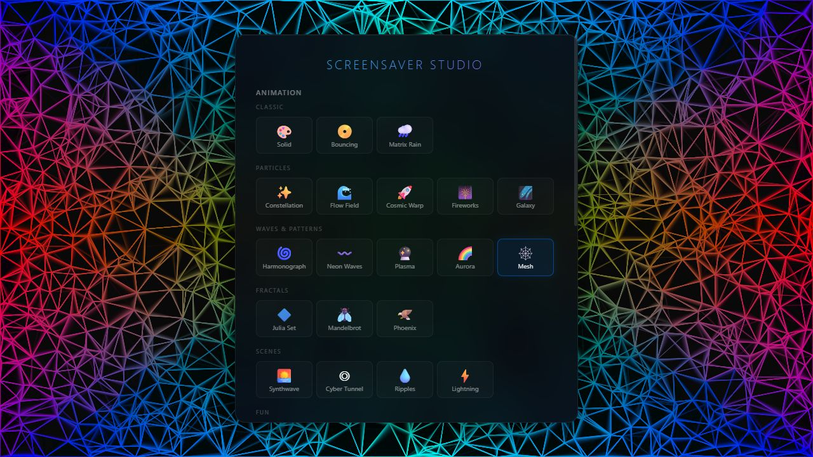
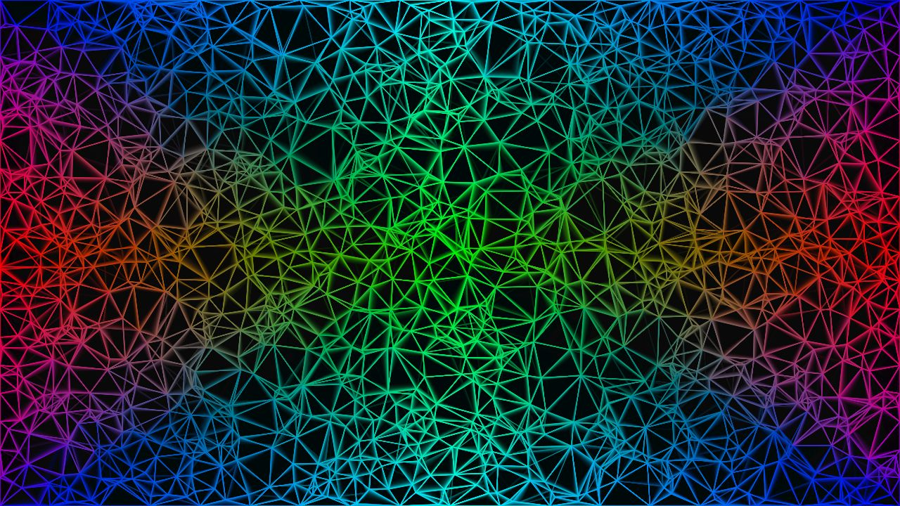
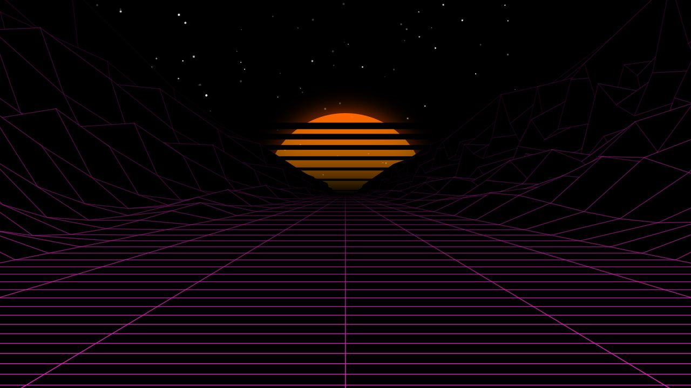
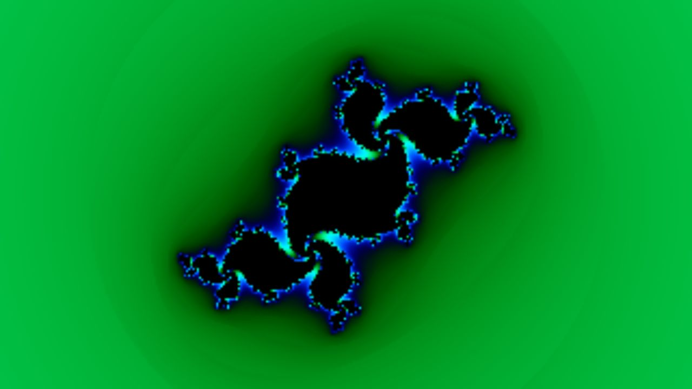
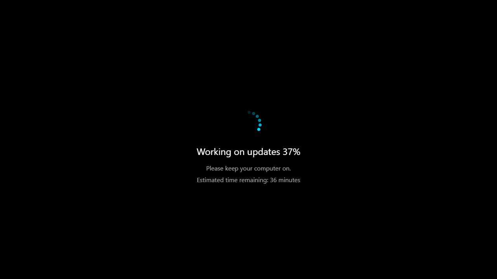
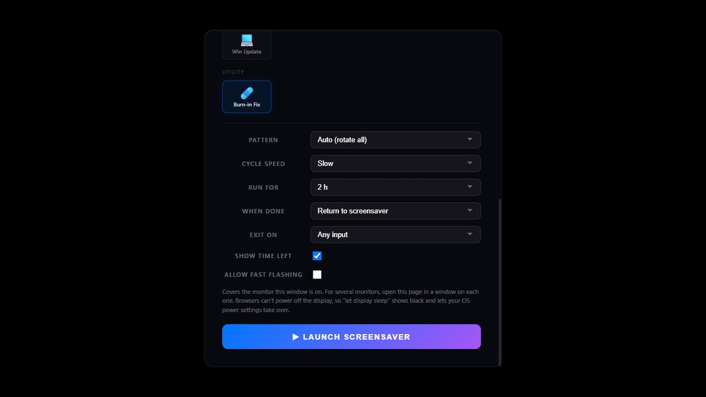

# Screensaver Studio

Full-screen animated backgrounds that run in the browser. Put one on a second monitor while you watch something or play a game, use it as a screensaver, or run the **Burn-in Fix** to clear ghosting on a display.

**[Open it: screen.maxpodolski.com](https://screen.maxpodolski.com/)**

No install, no build, no tracking. It's a static page (`index.html` + `script.js`) drawn on a single canvas.

## How to use

1. Open the page and pick an animation from the grid.
2. Tune it: the **Base Color** and the sliders under it update the background live.
3. Press **Launch Screensaver** to go full screen. Click or press a key to bring the panel back for a moment, and press `Esc` to leave full screen.

Pressing `F11` on its own works too: the panel hides itself when the window goes full screen.

All settings are stored in the page URL, so you can bookmark a setup or send it to someone. For example: [Mesh, full color](https://screen.maxpodolski.com/?type=mesh&color=%23ffffff).

## Animations

| Group | Animation | What it is |
|---|---|---|
| Classic | **Solid** | One flat color. Handy as a bias light or a plain backdrop. |
| | **Bouncing** | Your own text bouncing around and changing color when it hits an edge, DVD-logo style. |
| | **Matrix Rain** | Falling columns of characters. |
| Particles | **Constellation** | Drifting dots linked by lines when they get close. |
| | **Flow Field** | Particles carried by a moving vector field. |
| | **Cosmic Warp** | Flying through a star field. |
| | **Fireworks** | Rockets bursting into sparks with gravity. |
| | **Galaxy** | A rotating spiral galaxy with a glowing core. |
| Waves & Patterns | **Harmonograph** | A looping, rotating curve with trails. |
| | **Neon Waves** | Layered glowing sine waves. |
| | **Plasma** | Classic color plasma. |
| | **Aurora** | Northern lights curtains over a starry sky. |
| | **Mesh** | An animated Delaunay triangle mesh, with hotkeys (see below). |
| Fractals | **Julia Set** | A Julia set whose shape morphs over time. |
| | **Mandelbrot** | Zooms in and out of the Mandelbrot set. |
| | **Phoenix** | The Phoenix fractal with a slowly drifting view. |
| Scenes | **Synthwave** | A retro sun over a neon grid valley. |
| | **Cyber Tunnel** | Flying through a twisting tunnel of polygons. |
| | **Ripples** | Ripples spreading on water. |
| | **Lightning** | A storm with branching lightning strikes. |
| Fun | **Win Update** | A fake "Working on updates" screen (see below). |
| Utility | **Burn-in Fix** | Pixel refresh patterns for image retention (see below). |

Most animations have their own sliders (speed, density, trail length, detail and so on), and most of them are tinted by the Base Color.

<table>
  <tr>
    <td></td>
    <td></td>
  </tr>
  <tr>
    <td align="center">Mesh</td>
    <td align="center">Synthwave</td>
  </tr>
  <tr>
    <td></td>
    <td></td>
  </tr>
  <tr>
    <td align="center">Julia Set</td>
    <td align="center">Win Update</td>
  </tr>
</table>

### Win Update

A full-screen imitation of the Windows 11 update screen: a spinner, "Working on updates N%" and an estimated time left. The percentage creeps up very slowly and stops at 98%, so it never finishes. Good for pranks or for looking busy. The only setting is the spinner speed.

### Burn-in Fix (Pixel Refresh)

Plays full-screen test patterns that make every pixel change. This helps clear temporary **image retention** (ghosting), for example after a static taskbar or game HUD stayed on screen for hours. It can't undo permanent burn-in, which is physical wear on OLED and plasma panels.

| Setting | Options |
|---|---|
| Pattern | **Auto** (switches pattern every 3 minutes), Solid White, Color Cycle, Moving Bars, Noise |
| Cycle Speed | Slow, Medium. Fast only after you turn on *Allow Fast Flashing*. |
| Run For | 30 min, 1 h, 2 h, 4 h, 8 h, or until stopped |
| When Done | Go back to the previous animation, or show black and let the display sleep |
| Exit On | Any input, or the `Esc` key only (so a bumped mouse doesn't stop a long run) |
| Show Time Left | A small countdown that moves every 30 seconds so it can't burn in itself |

Safety: by default the screen changes at most 3 times per second, which is the WCAG 2.3.1 limit for flashing. Flashing patterns show a photosensitivity warning before they start, and the faster speed needs an extra opt-in with its own warning. While it runs, the page asks the browser to keep the screen awake.

It covers the monitor the window is on. For several monitors, open the page in a window on each one.

### Mesh hotkeys

Mesh started as a separate project, [Meshy](https://github.com/Lunat1q/Meshy), which is now archived. Its hotkeys work here while the animation is showing. Right-click the background or press `H` to see the list.

| Key | Action |
|---|---|
| `Space` / `Enter` | Add / remove points |
| `L` / `T` / `P` | Toggle lines / filled triangles / points |
| `R` / `G` / `B` | Toggle the red / green / blue channel |
| `1` / `2` / `3` | Gradient / random / animated circles colors |
| `A` | Pause or resume |
| `[` / `]` | Longer / shorter trail |
| `+` / `-` | Faster / slower points |
| `S` | Show point count and FPS |
| `H` or right-click | Show or hide the hotkey help |

For the original full-color look, set Base Color to white.

## Run it locally

Clone the repo and open `index.html` in a browser. There's nothing to install or build.

## Credits

The Mesh triangulation uses [Delaunator](https://github.com/mapbox/delaunator) by Mapbox (`delaunator.js`).

## License

[MIT](LICENSE)
